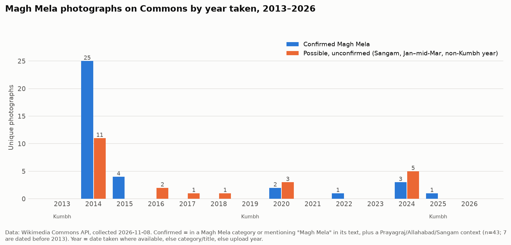
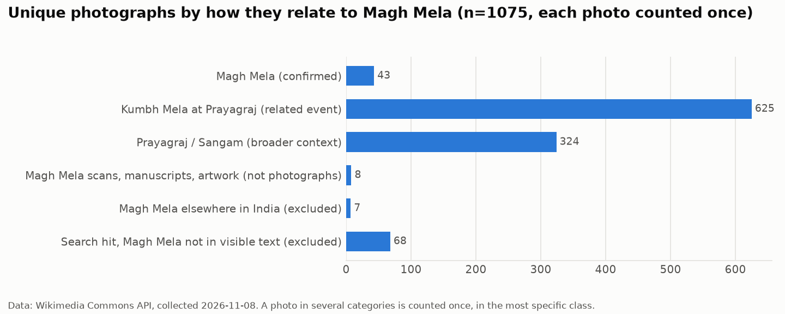
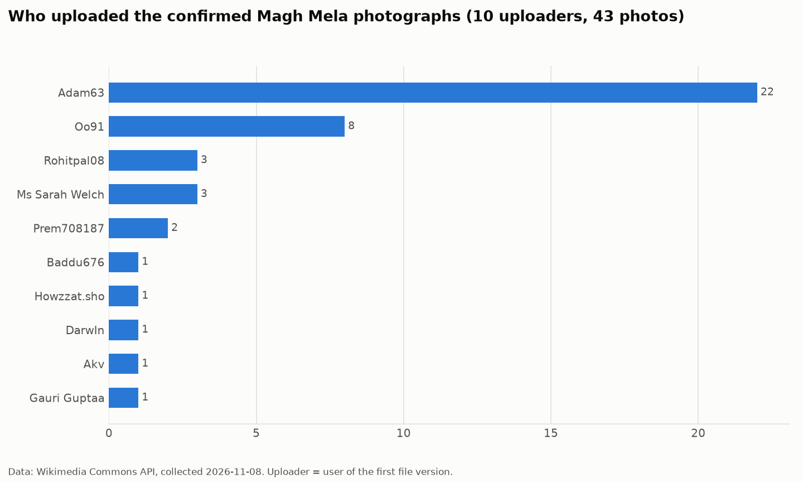
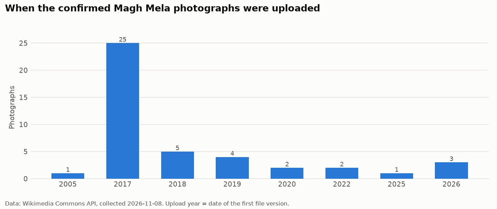
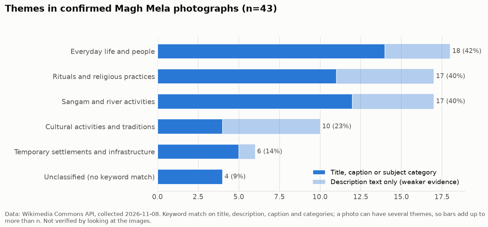

# Wikimedia Commons Visual Documentation Gap Analysis: Magh Mela, Prayagraj (2013–2026)

*Data collected from the Wikimedia Commons API on 2026-11-08 (21:52 UTC).
Scripts, raw data and per-file classifications are in this folder; see
[README.md](README.md) to reproduce every number.*

## Summary

| | Count | Status |
|---|---:|---|
| Unique files examined (all layers, no double counting) | 1,100 | confirmed |
| Unique photographs among them | 1,075 | confirmed |
| **Photographs confirmed as Magh Mela at Prayagraj** | **43** | confirmed |
| … of which dated 2013–2026 | 36 | confirmed |
| Unique uploaders of the 43 confirmed photographs | 10 | confirmed |
| Possible Magh Mela photographs that are not labelled as such, 2013–2026 | about 18 (23 before manual cleaning) | estimate |
| Photographs of the Kumbh Mela at Prayagraj (a related event in the same place and season) | 625 | confirmed, for context |

Main findings:

1. **There is very little Magh Mela material.** Fourteen Magh Mela seasons
   (2013–2026) are documented by **36** identifiable photographs.
2. **Coverage is concentrated in one batch.** 25 of the 36 (69%) are from
   2014. 22 of the 43 confirmed photos (51%) come from one Flickr account,
   imported to Commons in 2017.
3. **8 of 14 years have no confirmed photograph.** Those years are 2013, 2016,
   2017, 2018, 2019, 2021, 2023 and 2026. 2013, 2019 and 2025 were Kumbh years,
   when the Kumbh absorbs the Magh Mela. That still leaves 6 of the 11
   non-Kumbh seasons with nothing, including the most recent one (2026).
4. **Only one dedicated category exists.** That is
   [Category:Magh Mela Festival Allahabad 2014](https://commons.wikimedia.org/wiki/Category:Magh_Mela_Festival_Allahabad_2014),
   with 23 files. Twenty of the 43 confirmed photos are in no Magh Mela
   category at all and can only be found by full-text search.
5. **Whole subjects are missing.** No confirmed photograph shows Kalpvas,
   the akharas, aarti, the pontoon bridges, sanitation, health or
   administration services, food distribution, or the main bathing days
   (Mauni Amavasya, Basant Panchami). The Kumbh Mela material shows that
   these subjects are photographable and do get uploaded.



---

## 1. Scope and questions

**Event.** The Magh Mela is held every year at the Triveni Sangam in
Prayagraj (Allahabad) during the Hindu month of Magh, roughly January to
February. In Kumbh years (2013, 2025) and the Ardh Kumbh year (2019), the
Kumbh Mela takes place on the same ground in the same season and absorbs the
Magh Mela.

**Questions.**
1. How many Commons photographs of the Prayagraj Magh Mela exist for each year
   from 2013 to 2026?
2. Who took or uploaded them, and when?
3. How much of the material sits in dedicated categories, and how much only in
   broader ones?
4. Which subjects are covered, and which are missing?

---

## 2. Method

### 2.1 Data collection (`scripts/collect.py`)

All requests went to `https://commons.wikimedia.org/w/api.php`, with
`format=json`, `formatversion=2` and `maxlag=5`. Requests were sent one at a
time, with a 1-second pause between them. `continue` was followed until each
result set was complete, so no list was cut off at the API page limit.

Files were found in four separate **layers**. The layers are recorded per file
and are never merged in the counts.

| Layer | How files were found | API call |
|---|---|---|
| `dedicated` | Category pages whose name is about Magh Mela. Found by category search for *Magh Mela*, *Magha Mela*, *Maagh Mela* and *माघ मेला*, filtered with the pattern `magh…mela` (so *Magh Bihu* is excluded). Magh Mela categories used on file pages but never created (red links) were also walked. Each tree was walked to depth 3. | `list=search&srnamespace=14`; `list=categorymembers&cmtype=file\|subcat` |
| `search` | Full-text search of the File namespace for `"Magh Mela"`, `"Magha Mela"`, `"Maagh Mela"`, `"Maghmela"`, `"माघ मेला"` and `"माघ मेले"`. This searches titles, descriptions and categories. | `list=search&srnamespace=6` |
| `related` | The Kumbh Mela at Prayagraj: [Prayag Kumbh Mela](https://commons.wikimedia.org/wiki/Category:Prayag_Kumbh_Mela) (depth 3), [2013 Kumbh Mela](https://commons.wikimedia.org/wiki/Category:2013_Kumbh_Mela) (depth 2), [2019 Ardh Kumbh Mela](https://commons.wikimedia.org/wiki/Category:2019_Ardh_Kumbh_Mela) (depth 2) and [2025 Kumbh Mela](https://commons.wikimedia.org/wiki/Category:2025_Kumbh_Mela) (depth 3) | `list=categorymembers` |
| `broader` | [Prayagraj Triveni Sangam](https://commons.wikimedia.org/wiki/Category:Prayagraj_Triveni_Sangam) (depth 2), and [2013 in Prayagraj](https://commons.wikimedia.org/wiki/Category:2013_in_Prayagraj) to [2026 in Prayagraj](https://commons.wikimedia.org/wiki/Category:2026_in_Prayagraj) (depth 1 each) | `list=categorymembers` |

For every unique file, the script fetched:
- every file version, to get the original upload date and uploader:
  `prop=imageinfo&iiprop=timestamp|user|mime|size|extmetadata&iilimit=50`;
- the date taken (`DateTimeOriginal`) and the description (`ImageDescription`), both from `extmetadata`;
- all categories, both visible and hidden: `prop=categories&clprop=hidden`;
- the structured-data captions in English and Hindi: `action=wbgetentities&ids=M<pageid>`.

**De-duplication.** Each file is stored once, keyed by page ID. A file found
by several layers, categories or search terms is still one row; the row lists
every way it was found.

**Category walk check.** [PetScan](https://petscan.wmcloud.org/) walked the
dedicated category to depth 3. It found the same 23 files as the API walk,
with no differences in either direction (`scripts/petscan_check.py`).

### 2.2 Classification (`scripts/analyze.py`)

Only photographs are counted (JPEG, TIFF, WebP, HEIF). This excludes 25
PDF, PNG, GIF and video files.

Each photograph gets **one** class, the most specific that applies:

| Class | Rule |
|---|---|
| **Magh Mela (confirmed)** | In a Magh Mela category, or "Magh Mela" (any spelling, English or Hindi) appears in the title, description, caption or categories. **And** the text places it at Prayagraj, Allahabad or the Sangam. **And** it is not a scan or artwork. **And** its title does not name the Kumbh. |
| Magh Mela scans, manuscripts, artwork | As above, but the title or categories describe a manuscript, book page, painting, postcard, map or similar. |
| Magh Mela elsewhere in India | The text says "Magh Mela" but gives no Prayagraj context. Examples: Uttarkashi, Jharkhand, Farrukhabad. |
| Search hit, Magh Mela not in visible text | Full-text search matched, but the phrase is not in the title, description, caption or visible categories. Most are Makar Sankranti photos from other states that have hidden or templated text. |
| Kumbh Mela at Prayagraj | In a Kumbh category, or a Magh Mela match whose title names the Kumbh. |
| Prayagraj / Sangam (broader context) | Everything else, from the broader layer. |

**Year.** The year comes from the first source that gives one:
1. the date taken (EXIF/`DateTimeOriginal`);
2. the year in the file title. If the title year disagrees with EXIF, the title
   wins and the conflict is recorded. Example: a camera clock set to 2026 on a
   photo titled "… 2024";
3. the year in an event category;
4. the upload year, as a fallback.

`year_source` in `files.csv` shows which one was used for each file. For the
43 confirmed photos the breakdown is:

| Source | Photos |
|---|---:|
| Date taken | 39 |
| File title | 1 |
| File title, overriding a conflicting EXIF date | 2 |
| Upload year | 1 |

**Uploader** is the user of the first file version. For Flickr imports this is
the Commons user who did the import; the photographer is named in the file
description.

**Possible (unconfirmed) Magh Mela photographs.** This is an estimate. It
counts photographs in the broader layer that meet all three of these:
- taken between 1 January and 15 March;
- taken in a non-Kumbh year;
- described with Sangam or mela words (sangam, ghat, snan, pilgrim, mela and similar).

They may show the Magh Mela but are not labelled as such. They are **never**
added to the confirmed count.

**Themes.** These are tagged by keyword, and one photo can have several. The
keyword lists are in `THEMES` in `analyze.py`.

Before matching, place and event names ("Magh Mela Festival – Sangam Site –
Allahabad") are removed, and so are location and event categories, so that
they don't trigger themes.

Matches are split by evidence strength:
- **strong:** the match is in the title, caption or a subject category written for that file;
- **weaker:** the match is only in the description. Batches often share one long generic description.

Themes were **not** checked by looking at the images.

---

## 3. Results

### 3.1 What the 1,075 photographs are

Each photograph is counted once, in its most specific class.

| Class | Photographs |
|---|---:|
| Magh Mela (confirmed) | 43 |
| Kumbh Mela at Prayagraj (related event) | 625 |
| Prayagraj / Sangam (broader context) | 324 |
| Search hit, Magh Mela not in visible text (excluded) | 68 |
| Magh Mela scans, manuscripts, artwork (excluded) | 8 |
| Magh Mela elsewhere in India (excluded) | 7 |
| **Total** | **1,075** |



Text search matters more than categories here:
- **23** of the 43 confirmed photographs were found by **both** a dedicated category and search;
- **20** were found by **search only**;
- none were found by category alone.

A category-only survey would have missed nearly half (47%) of the confirmed
material.

Text search on its own would have over-counted. Of the 139 photographs it
returned:
- 83 (60%) are not Prayagraj Magh Mela photographs: 68 have no Magh Mela
  text, 8 are scans and 7 are from elsewhere in India;
- a further 12 are Kumbh photographs.

### 3.2 By year taken (2013–2026)

| Year | Confirmed Magh Mela | Possible, unconfirmed | Kumbh at Prayagraj | Broader Prayagraj / Sangam |
|---|---:|---:|---:|---:|
| 2013 (Kumbh) | 0 | – | 36 | 12 |
| 2014 | **25** | 11 | 0 | 87 |
| 2015 | 4 | 0 | 0 | 81 |
| 2016 | 0 | 2 | 2 | 7 |
| 2017 | 0 | 1 | 0 | 9 |
| 2018 | 0 | 1 | 2 | 10 |
| 2019 (Ardh Kumbh) | 0 | – | 337 | 3 |
| 2020 | 2 | 3 | 0 | 6 |
| 2021 | 0 | 0 | 1 | 6 |
| 2022 | 1 | 0 | 0 | 5 |
| 2023 | 0 | 0 | 1 | 2 |
| 2024 | 3 | 5 | 12 | 6 |
| 2025 (Kumbh) | 1 | – | 221 | 45 |
| 2026 | 0 | 0 | 0 | 3 |
| **2013–2026** | **36** | **23** | **612** | **282** |

The "possible" column is not computed for Kumbh years (shown as –).

**Confirmed photographs from before 2013 (7).** These count in the confirmed
total of 43 but are outside the study window:
- one news-bureau photo from 1954;
- one upload from 2005;
- four photos from 2009;
- one from 2010.

**Cleaning the "possible" estimate.** The 23 possible photographs from
2013–2026 include 5 that are clearly not of the Mela, found by reading their
titles:
- four International Space Station frames titled "View of India" (2014);
- one personal portrait (2016).

That leaves **about 18**. Six of the 2014 ones are by the same Flickr
photographer as the 2014 dedicated batch:
- Patalpuri Temple idols;
- the flag over Akbar's Fort;
- a man with a mannequin.

Their EXIF timestamps (17 February 2014, 02:06–02:43) come straight after
the Magh Mela series (00:17–01:39 the same night), and they are titled
"Sangam Site". They are very likely from the same Magh Mela visit. **Upper estimate for
2013–2026:** 36 confirmed + about 18 possible = **about 54 photographs**,
spread over 14 seasons.

### 3.3 Contributors



Ten Commons accounts uploaded the 43 confirmed photographs:
- **Adam63:** 22 (51%), all imported from Flickr;
- **Oo91:** 8 (19%), all imported from Flickr;
- the other 8 accounts: 13 between them.

Most of the material was not uploaded by people photographing for Commons:
- **30 of 43** file names carry a Flickr photo ID;
- **33 of 43** are under CC BY 2.0 or CC BY-SA 2.0, the Flickr licences.

Only 7 confirmed photos are under CC BY-SA 4.0 or CC0, the licences of a
typical "own work" upload.

Across all 1,075 photographs in every layer there are 161 uploaders. Kumbh
years draw photographers; ordinary Magh Mela seasons do not.

### 3.4 When the photographs were uploaded



25 of the 43 confirmed photographs were uploaded in a single year, 2017. That
was a bulk Flickr import of photos taken in 2014.

There has been no steady stream of new uploads since. Between 2020 and 2026
only 8 confirmed Magh Mela photographs were uploaded.

### 3.5 Themes



A photo can have several themes, so the columns add up to more than 43.

| Theme | Strong evidence | Description text only | Total | Share of 43 |
|---|---:|---:|---:|---:|
| Everyday life and people | 14 | 4 | 18 | 42% |
| Rituals and religious practices | 11 | 6 | 17 | 40% |
| Sangam and river activities | 12 | 5 | 17 | 40% |
| Cultural activities and traditions | 4 | 6 | 10 | 23% |
| Temporary settlements and infrastructure | 5 | 1 | 6 | 14% |
| Architecture and public spaces | 0 | 0 | **0** | 0% |
| Unclassified (no keyword match) | – | – | 4 | 9% |

Some theme tags are uncertain:
- **Four 2015 Flickr photos** (Oo91, "Allahabad, Triveni Sangam 21/24/27/28")
  share one long description about the Kumbh and Magh Mela. That text matches
  four themes, but none of those matches is strong. In the CSV their themes
  are listed under `themes_description_only`.
- **The 2014 batch** (25 photos) makes up most of the "Everyday life" count.
  Many of its photos are portraits of vendors and women.

**Specific subjects.** These are keyword counts on title, description, caption
and categories. They indicate presence only and are not a full inventory.

| Subject | Confirmed Magh Mela (n=43) | Kumbh at Prayagraj (n=625) |
|---|---:|---:|
| Kalpvas / Kalpvasis | 0 | 29 |
| Mauni Amavasya | 0 | 29 |
| Basant Panchami | 0 | 0 |
| Makar Sankranti | 5 | 9 |
| Maghi Purnima | 1 | 2 |
| Akharas | 0 | 3 |
| Naga sadhus | 0 | 33 |
| Aarti | 0 | 3 |
| Night scenes / illumination | 2 | 57 |
| Pontoon bridges | 0 | 9 |
| Tents / camps | 4 | 32 |
| Aerial / drone views | 1 | 5 |
| Food distribution / bhandara | 0 | 13 |
| Sanitation / health services | 0 | 2 |
| Police / administration | 0 | 6 |
| Boats | 2 | 28 |
| Migratory birds (gulls) | 2 | 0 |
| Markets / shops / vendors | 4 | 6 |

---

## 4. What is confirmed, what is estimated, and the limitations

**Confirmed.** These facts can be checked by opening the file pages listed in
the appendix:
- the counts of unique files and photographs, and each photograph's class;
- the 43 confirmed Magh Mela photographs, their uploaders and upload dates;
- that only one dedicated Magh Mela category exists, with 23 files. PetScan
  confirms this;
- that no confirmed photograph from 2016–2019, 2021, 2023 or 2026 was found
  by any of the methods above.

**Estimated:**
- the year taken, where it comes from EXIF. Camera clocks can be wrong. Two
  conflicts were found and resolved from the file title, and others may be
  undetected;
- the "possible" count of about 18;
- the themes and subject counts, which come from keywords and are not checked
  against the images.

**Limitations:**
1. **Unlabelled photographs can't be found from text.** A Magh Mela photo
   titled "IMG_1234.jpg", in no relevant category and without the phrase,
   is invisible to this method. The "possible" layer covers part of this gap,
   but only for files in Prayagraj or Sangam categories.
2. **Category coverage.** The broader layer was limited to the Triveni Sangam
   tree and the "<year> in Prayagraj" categories. Photos filed only under
   ghats, temples or neighbourhoods were not walked. Many "<year> in
   Prayagraj" categories are near-empty: 2023 and 2024 have 0 files.
3. **Search index.** CirrusSearch results reflect the search index at the
   time of collection and can differ slightly from the live wiki.
4. **Uploader ≠ photographer.** For Flickr imports the uploader is the
   importer, so counting distinct photographers would need the `Artist`
   field, which is free text.
5. **Kumbh overlap.** A photo in a Kumbh category, or with "Kumbh" in its
   title, is counted as Kumbh even if it mentions the Magh Mela. 12 search
   hits were moved there this way. A Kumbh-year photo titled only as Magh
   Mela stays confirmed; one 2025 drone shot is in that position.
6. **Snapshot.** The data reflects Commons on 2026-11-08.

---

## 5. Visual Documentation Gaps and Opportunities for Magh Mela 2027

### 5.1 Gaps found in the data

| Gap | Evidence |
|---|---|
| **No recent coverage** | 0 confirmed photos of the 2026 Magh Mela. Only 6 confirmed photos from the non-Kumbh seasons since 2020 (2 from 2020, 1 from 2022, 3 from 2024). [2023 in Prayagraj](https://commons.wikimedia.org/wiki/Category:2023_in_Prayagraj) and [2024 in Prayagraj](https://commons.wikimedia.org/wiki/Category:2024_in_Prayagraj) hold 0 files. |
| **No year-by-year record** | 8 of 14 years have no confirmed photographs. 2014 alone accounts for 69% of the 2013–2026 material (25 of 36). One Flickr series shot on a single day, 17 February 2014, accounts for 61% (22 of 36). |
| **Narrow contributor base** | Two Flickr importers account for 30 of 43 photos. Few Commons photographers have uploaded their own Magh Mela photos (7 under CC BY-SA 4.0 or CC0). |
| **Weak categorisation** | One dedicated category (2014 only). [Category:Magh Mela](https://commons.wikimedia.org/wiki/Category:Magh_Mela) is used on a file but has never been created. 20 of 43 confirmed photos are in no Magh Mela category. |
| **Bathing days** | No confirmed photo is tied to Mauni Amavasya or Basant Panchami. Makar Sankranti has 5 and Maghi Purnima 1. |
| **Kalpvas** | 0 confirmed photos of Kalpvasis, the pilgrims who stay at the Sangam for the whole month and are central to the Magh Mela. |
| **Organisations and infrastructure** | 0 photos of akharas, pontoon bridges, sanitation, health or police services, or food distribution. 5 strong-evidence photos of temporary settlements: 4 of the tent city and 1 drone view. |
| **Architecture and public spaces** | 0 confirmed. The Patalpuri Temple and Akbar's Fort appear only in the unconfirmed 2014 set. |
| **Evening and night** | 2 confirmed photos with night or illumination keywords, against 57 in the Kumbh material. |
| **Captions and structured data** | 6 of 43 confirmed files have a structured-data caption. Description text is often generic and copied across a batch. |

### 5.2 Opportunities for a 2027 campaign

These follow directly from the gaps above.

1. **Plan around the main bathing days.** Organise photo walks on Makar
   Sankranti, Mauni Amavasya, Basant Panchami and Maghi Purnima. Take the
   2027 dates from the official Magh Mela calendar of the Prayagraj Mela
   Authority. Name each day in the file title and in a category.
2. **Document Kalpvas over the whole month.** Follow a few consenting
   Kalpvasi households, with their camps, daily routine and departure. No
   such series exists on Commons.
3. **Infrastructure as subject matter.** Pontoon bridges, sectors and
   signage, sanitation, health camps, lost-and-found centres, police and
   control rooms, power and lighting. Where rules allow, include an aerial
   or high-angle overview of the mela area.
4. **Akharas, aarti, bhandaras and cultural pandals.** Collect named,
   captioned photos so each can be used in Wikipedia articles.
5. **Places.** Ghats, the Sangam nose, Akbar's Fort, the Patalpuri Temple
   and the Akshayavat, the Bade Hanuman Mandir, and approach roads. Shoot
   them during the mela so the images show the site in use.
6. **Evening and night.** Aarti, illuminated camps and the river at dusk.
7. **Build the category structure before the event.**
   - Create `Category:Magh Mela` and `Category:Magh Mela 2027`.
   - Under 2027, add subcategories for bathing days and for the themes above.
   - Fold the existing [Magh Mela Festival Allahabad 2014](https://commons.wikimedia.org/wiki/Category:Magh_Mela_Festival_Allahabad_2014) category into the new tree.
   - Ask participants to add structured-data captions in Hindi and English,
     plus a "depicts" (P180) statement.
8. **Recategorise what already exists.** As a small pre-campaign task, move
   the 20 confirmed but uncategorised photos and the about 18 possible ones
   into the new tree, after checking each image by eye.
9. **Measure the campaign with these scripts.** Running `collect.py` and
   `analyze.py` again after the campaign gives a before-and-after comparison
   against the 2026-11-08 baseline. The baseline is 43 confirmed photos, 10
   uploaders, and 0 photos for 2026.

**Note on people photography.** Many of the gaps involve people: Kalpvasis,
sadhus, pilgrims bathing. Participants should follow
[Commons:Photographs of identifiable people](https://commons.wikimedia.org/wiki/Commons:Photographs_of_identifiable_people),
get consent for portraits, and take extra care at bathing sites.

---

## 6. Reproducibility

```bash
cd scripts
../.venv/bin/python collect.py      # raw data  -> data/raw/
../.venv/bin/python analyze.py      # stats, CSV, charts -> data/processed/, charts/
../.venv/bin/python petscan_check.py
```

Every number in this report is in `data/processed/stats.json`, or can be
recomputed from `data/processed/files.csv`.

The CSV columns are: `class`, `year`, `year_source`, `uploader`, `themes`,
`themes_strong`, `themes_description_only`, `layers` (which method found the
file), `found_in_categories`, `search_terms` and `url`.

---

## Appendix A. Categories examined

Dedicated (found by search, or used on file pages):
- [Category:Magh Mela Festival Allahabad 2014](https://commons.wikimedia.org/wiki/Category:Magh_Mela_Festival_Allahabad_2014): 23 files
- [Category:Magh Mela](https://commons.wikimedia.org/wiki/Category:Magh_Mela): 1 file. The category page does not exist.
- [Category:Magh mela uttrakshi](https://commons.wikimedia.org/wiki/Category:Magh_mela_uttrakshi): 1 file. Uttarkashi, not Prayagraj, so excluded.

Related (Kumbh at Prayagraj), with files found in each tree:
- [Prayag Kumbh Mela](https://commons.wikimedia.org/wiki/Category:Prayag_Kumbh_Mela): 638
- [2013 Kumbh Mela](https://commons.wikimedia.org/wiki/Category:2013_Kumbh_Mela): 32
- [2019 Ardh Kumbh Mela](https://commons.wikimedia.org/wiki/Category:2019_Ardh_Kumbh_Mela): 337
- [2025 Kumbh Mela](https://commons.wikimedia.org/wiki/Category:2025_Kumbh_Mela): 239

These trees overlap. Each file is counted once in the results.

Broader:
- [Prayagraj Triveni Sangam](https://commons.wikimedia.org/wiki/Category:Prayagraj_Triveni_Sangam): 172
- "<year> in Prayagraj":

| 2013 | 2014 | 2015 | 2016 | 2017 | 2018 | 2019 | 2020 | 2021 | 2022 | 2023 | 2024 | 2025 | 2026 |
|---:|---:|---:|---:|---:|---:|---:|---:|---:|---:|---:|---:|---:|---:|
| 36 | 100 | 95 | 3 | 1 | 2 | 337 | 3 | 6 | 1 | 0 | 0 | 226 | 2 |

The full list of every category walked, with its depth, is in
`data/raw/discovery.json`.

## Appendix B. The 43 confirmed Magh Mela photographs

Sorted by year taken. "Found by" lists the collection layers that returned the file.

| Year | File | Uploader | Year from | Found by |
|---|---|---|---|---|
| 1954 | [Sadhus at the Magh mela, 1954 a news bureau photo.jpg](https://commons.wikimedia.org/wiki/File%3ASadhus_at_the_Magh_mela%2C_1954_a_news_bureau_photo.jpg) | Baddu676 | file title | dedicated, search |
| 2005 | [Magh mela allahabad.JPG](https://commons.wikimedia.org/wiki/File%3AMagh_mela_allahabad.JPG) | Akv | upload year (fallback) | search |
| 2009 | [131 Ganges River in Allahabad (3269083250).jpg](https://commons.wikimedia.org/wiki/File%3A131_Ganges_River_in_Allahabad_%283269083250%29.jpg) | Oo91 | date taken (EXIF/description) | search |
| 2009 | [132 Allahabad (3268266913).jpg](https://commons.wikimedia.org/wiki/File%3A132_Allahabad_%283268266913%29.jpg) | Oo91 | date taken (EXIF/description) | broader, search |
| 2009 | [134 Ganges River in Allahabad (3269105546).jpg](https://commons.wikimedia.org/wiki/File%3A134_Ganges_River_in_Allahabad_%283269105546%29.jpg) | Oo91 | date taken (EXIF/description) | search |
| 2009 | [135 Allahabad (3279416320).jpg](https://commons.wikimedia.org/wiki/File%3A135_Allahabad_%283279416320%29.jpg) | Oo91 | date taken (EXIF/description) | search |
| 2010 | [Display of statues, Makar Sankranti Hindu festival, Magh Mela at Prayaga Sangam Uttar Pradesh India.jpg](https://commons.wikimedia.org/wiki/File%3ADisplay_of_statues%2C_Makar_Sankranti_Hindu_festival%2C_Magh_Mela_at_Prayaga_Sangam_Uttar_Pradesh_India.jpg) | Ms Sarah Welch | date taken (EXIF/description) | broader, search |
| 2014 | [Ceremonial Dye Powder - Magh Mela Festival - Sangam Site - Allahabad - Uttar Pradesh - India (12590033403).jpg](https://commons.wikimedia.org/wiki/File%3ACeremonial_Dye_Powder_-_Magh_Mela_Festival_-_Sangam_Site_-_Allahabad_-_Uttar_Pradesh_-_India_%2812590033403%29.jpg) | Adam63 | date taken (EXIF/description) | broader, dedicated, search |
| 2014 | [Elderly Man at Magh Mela Festival - Sangam Site - Allahabad - Uttar Pradesh - India - 01 (12589991863).jpg](https://commons.wikimedia.org/wiki/File%3AElderly_Man_at_Magh_Mela_Festival_-_Sangam_Site_-_Allahabad_-_Uttar_Pradesh_-_India_-_01_%2812589991863%29.jpg) | Adam63 | date taken (EXIF/description) | broader, dedicated, search |
| 2014 | [Elderly Man at Magh Mela Festival - Sangam Site - Allahabad - Uttar Pradesh - India - 02 (12589967783).jpg](https://commons.wikimedia.org/wiki/File%3AElderly_Man_at_Magh_Mela_Festival_-_Sangam_Site_-_Allahabad_-_Uttar_Pradesh_-_India_-_02_%2812589967783%29.jpg) | Adam63 | date taken (EXIF/description) | broader, dedicated, search |
| 2014 | [Family with Flag - Magh Mela Festival - Sangam Site - Allahabad - Uttar Pradesh - India (12589948163).jpg](https://commons.wikimedia.org/wiki/File%3AFamily_with_Flag_-_Magh_Mela_Festival_-_Sangam_Site_-_Allahabad_-_Uttar_Pradesh_-_India_%2812589948163%29.jpg) | Adam63 | date taken (EXIF/description) | broader, dedicated, search |
| 2014 | [Ice Cream Vendor at Magh Mela Festival - Sangam Site - Allahabad - Uttar Pradesh - India (12590256224).jpg](https://commons.wikimedia.org/wiki/File%3AIce_Cream_Vendor_at_Magh_Mela_Festival_-_Sangam_Site_-_Allahabad_-_Uttar_Pradesh_-_India_%2812590256224%29.jpg) | Adam63 | date taken (EXIF/description) | broader, dedicated, search |
| 2014 | [Jhoola (58304012).jpeg](https://commons.wikimedia.org/wiki/File%3AJhoola_%2858304012%29.jpeg) | DarwIn | date taken (EXIF/description) | broader, search |
| 2014 | [Makar Sankranti Hindu festival, Magh Mela at Prayaga Sangam Uttar Pradesh India.jpg](https://commons.wikimedia.org/wiki/File%3AMakar_Sankranti_Hindu_festival%2C_Magh_Mela_at_Prayaga_Sangam_Uttar_Pradesh_India.jpg) | Ms Sarah Welch | date taken (EXIF/description) | broader, dedicated, search |
| 2014 | [Panorama of Yamnua Riverbank - Magh Mela Festival Sangam Site - Allahabad - Uttar Pradesh - India - 02 (12590142224).jpg](https://commons.wikimedia.org/wiki/File%3APanorama_of_Yamnua_Riverbank_-_Magh_Mela_Festival_Sangam_Site_-_Allahabad_-_Uttar_Pradesh_-_India_-_02_%2812590142224%29.jpg) | Adam63 | date taken (EXIF/description) | broader, search |
| 2014 | [Panorama of Yamuna Riverbank - Magh Mela Festival Sangam Site - Allahabad - Uttar Pradesh - India - 01 (12589803113).jpg](https://commons.wikimedia.org/wiki/File%3APanorama_of_Yamuna_Riverbank_-_Magh_Mela_Festival_Sangam_Site_-_Allahabad_-_Uttar_Pradesh_-_India_-_01_%2812589803113%29.jpg) | Adam63 | date taken (EXIF/description) | broader, search |
| 2014 | [Pilgrim Boat with Seagulls - Sangam Site - Allahabad - Uttar Pradesh - India (12589795863).jpg](https://commons.wikimedia.org/wiki/File%3APilgrim_Boat_with_Seagulls_-_Sangam_Site_-_Allahabad_-_Uttar_Pradesh_-_India_%2812589795863%29.jpg) | Adam63 | date taken (EXIF/description) | broader, dedicated, search |
| 2014 | [Pilgrims and Seagulls - Magh Mela Festival Sangam Site - Allahabad - Uttar Pradesh - India (12590098074).jpg](https://commons.wikimedia.org/wiki/File%3APilgrims_and_Seagulls_-_Magh_Mela_Festival_Sangam_Site_-_Allahabad_-_Uttar_Pradesh_-_India_%2812590098074%29.jpg) | Adam63 | date taken (EXIF/description) | broader, dedicated, search |
| 2014 | [Pilgrims at Magh Mela Festival - Sangam Site - Allahabad - Uttar Pradesh - India (12589312183).jpg](https://commons.wikimedia.org/wiki/File%3APilgrims_at_Magh_Mela_Festival_-_Sangam_Site_-_Allahabad_-_Uttar_Pradesh_-_India_%2812589312183%29.jpg) | Adam63 | date taken (EXIF/description) | broader, dedicated, search |
| 2014 | [Pilgrims at Magh Mela Festival Sangam Site - Allahabad - Uttar Pradesh - India (12589647045).jpg](https://commons.wikimedia.org/wiki/File%3APilgrims_at_Magh_Mela_Festival_Sangam_Site_-_Allahabad_-_Uttar_Pradesh_-_India_%2812589647045%29.jpg) | Adam63 | date taken (EXIF/description) | broader, dedicated, search |
| 2014 | [Riverfront Scene - Yamuna River - During Magh Mela Festival Sangam Site - Allahabad - Uttar Pradesh - India (12589625145).jpg](https://commons.wikimedia.org/wiki/File%3ARiverfront_Scene_-_Yamuna_River_-_During_Magh_Mela_Festival_Sangam_Site_-_Allahabad_-_Uttar_Pradesh_-_India_%2812589625145%29.jpg) | Adam63 | date taken (EXIF/description) | broader, dedicated, search |
| 2014 | [Trio of Women in Saris - Magh Mela Festival Sangam Site - Allahabad - Uttar Pradesh - India (12589386715).jpg](https://commons.wikimedia.org/wiki/File%3ATrio_of_Women_in_Saris_-_Magh_Mela_Festival_Sangam_Site_-_Allahabad_-_Uttar_Pradesh_-_India_%2812589386715%29.jpg) | Adam63 | date taken (EXIF/description) | broader, dedicated, search |
| 2014 | [Vendor during Magh Mela Festival - Sangam Site - Allahabad - Uttar Pradesh - India - 01 (12589744444).jpg](https://commons.wikimedia.org/wiki/File%3AVendor_during_Magh_Mela_Festival_-_Sangam_Site_-_Allahabad_-_Uttar_Pradesh_-_India_-_01_%2812589744444%29.jpg) | Adam63 | date taken (EXIF/description) | broader, dedicated, search |
| 2014 | [Vendor during Magh Mela Festival - Sangam Site - Allahabad - Uttar Pradesh - India - 02 (12589727174).jpg](https://commons.wikimedia.org/wiki/File%3AVendor_during_Magh_Mela_Festival_-_Sangam_Site_-_Allahabad_-_Uttar_Pradesh_-_India_-_02_%2812589727174%29.jpg) | Adam63 | date taken (EXIF/description) | broader, dedicated, search |
| 2014 | [View over Tent City for Pilgrims at Magh Mela Festival - Sangam Site - Allahabad - Uttar Pradesh - India (12589692674).jpg](https://commons.wikimedia.org/wiki/File%3AView_over_Tent_City_for_Pilgrims_at_Magh_Mela_Festival_-_Sangam_Site_-_Allahabad_-_Uttar_Pradesh_-_India_%2812589692674%29.jpg) | Adam63 | date taken (EXIF/description) | broader, dedicated, search |
| 2014 | [Woman Dressing in Sari - Magh Mela Festival Sangam Site - Allahabad - Uttar Pradesh - India (12589169053).jpg](https://commons.wikimedia.org/wiki/File%3AWoman_Dressing_in_Sari_-_Magh_Mela_Festival_Sangam_Site_-_Allahabad_-_Uttar_Pradesh_-_India_%2812589169053%29.jpg) | Adam63 | date taken (EXIF/description) | broader, dedicated, search |
| 2014 | [Woman at Magh Mela Festival Sangam Site - Allahabad - Uttar Pradesh - India - 01 (12589237225).jpg](https://commons.wikimedia.org/wiki/File%3AWoman_at_Magh_Mela_Festival_Sangam_Site_-_Allahabad_-_Uttar_Pradesh_-_India_-_01_%2812589237225%29.jpg) | Adam63 | date taken (EXIF/description) | broader, dedicated, search |
| 2014 | [Woman at Magh Mela Festival Sangam Site - Allahabad - Uttar Pradesh - India - 02 (12589184603).jpg](https://commons.wikimedia.org/wiki/File%3AWoman_at_Magh_Mela_Festival_Sangam_Site_-_Allahabad_-_Uttar_Pradesh_-_India_-_02_%2812589184603%29.jpg) | Adam63 | date taken (EXIF/description) | broader, dedicated, search |
| 2014 | [Women on Yamuna Riverbank at Magh Mela Festival Sangam Site - Allahabad - Uttar Pradesh - India (12589036575).jpg](https://commons.wikimedia.org/wiki/File%3AWomen_on_Yamuna_Riverbank_at_Magh_Mela_Festival_Sangam_Site_-_Allahabad_-_Uttar_Pradesh_-_India_%2812589036575%29.jpg) | Adam63 | date taken (EXIF/description) | broader, dedicated, search |
| 2014 | [Yamuna River Scene during Magh Mela Festival Sangam Site - Allahabad - Uttar Pradesh - India (12589117923).jpg](https://commons.wikimedia.org/wiki/File%3AYamuna_River_Scene_during_Magh_Mela_Festival_Sangam_Site_-_Allahabad_-_Uttar_Pradesh_-_India_%2812589117923%29.jpg) | Adam63 | date taken (EXIF/description) | broader, dedicated, search |
| 2014 | [Young Girl in Ceremonial Dress - Magh Mela Festival - Sangam Site - Allahabad - Uttar Pradesh - India (12588987865).jpg](https://commons.wikimedia.org/wiki/File%3AYoung_Girl_in_Ceremonial_Dress_-_Magh_Mela_Festival_-_Sangam_Site_-_Allahabad_-_Uttar_Pradesh_-_India_%2812588987865%29.jpg) | Adam63 | date taken (EXIF/description) | broader, dedicated, search |
| 2014 | [Young man bathing at Makar Sankranti Magh Mela Festival Ganga Yamuna Sangam Uttar Pradesh India.jpg](https://commons.wikimedia.org/wiki/File%3AYoung_man_bathing_at_Makar_Sankranti_Magh_Mela_Festival_Ganga_Yamuna_Sangam_Uttar_Pradesh_India.jpg) | Ms Sarah Welch | date taken (EXIF/description) | broader, dedicated, search |
| 2015 | [Allahabad, Triveni Sangam 21 (38650098264).jpg](https://commons.wikimedia.org/wiki/File%3AAllahabad%2C_Triveni_Sangam_21_%2838650098264%29.jpg) | Oo91 | date taken (EXIF/description) | broader, search |
| 2015 | [Allahabad, Triveni Sangam 24 - Adarsh Credit Cooperative Society (38650113284).jpg](https://commons.wikimedia.org/wiki/File%3AAllahabad%2C_Triveni_Sangam_24_-_Adarsh_Credit_Cooperative_Society_%2838650113284%29.jpg) | Oo91 | date taken (EXIF/description) | broader, search |
| 2015 | [Allahabad, Triveni Sangam 27 (39310070552).jpg](https://commons.wikimedia.org/wiki/File%3AAllahabad%2C_Triveni_Sangam_27_%2839310070552%29.jpg) | Oo91 | date taken (EXIF/description) | broader, search |
| 2015 | [Allahabad, Triveni Sangam 28 (27562689029).jpg](https://commons.wikimedia.org/wiki/File%3AAllahabad%2C_Triveni_Sangam_28_%2827562689029%29.jpg) | Oo91 | date taken (EXIF/description) | broader, search |
| 2020 | [Sangham mela 01.jpg](https://commons.wikimedia.org/wiki/File%3ASangham_mela_01.jpg) | Prem708187 | date taken (EXIF/description) | related, search |
| 2020 | [Sangham mela 02.jpg](https://commons.wikimedia.org/wiki/File%3ASangham_mela_02.jpg) | Prem708187 | date taken (EXIF/description) | broader, search |
| 2022 | [Magh Mela 2022.jpg](https://commons.wikimedia.org/wiki/File%3AMagh_Mela_2022.jpg) | Howzzat.sho | date taken (EXIF/description) | broader, search |
| 2024 | [Temporary Tent City at Magh Mela Prayagraj 2024 01.jpg](https://commons.wikimedia.org/wiki/File%3ATemporary_Tent_City_at_Magh_Mela_Prayagraj_2024_01.jpg) | Rohitpal08 | file title (date taken says 2026) | search |
| 2024 | [Temporary Tent City at Magh Mela Prayagraj 2024 02.jpg](https://commons.wikimedia.org/wiki/File%3ATemporary_Tent_City_at_Magh_Mela_Prayagraj_2024_02.jpg) | Rohitpal08 | file title (date taken says 2026) | search |
| 2024 | [Temporary Tent City at Magh Mela Prayagraj 2024.jpg](https://commons.wikimedia.org/wiki/File%3ATemporary_Tent_City_at_Magh_Mela_Prayagraj_2024.jpg) | Rohitpal08 | date taken (EXIF/description) | search |
| 2025 | [Drone shot that show significance of world famous magh mela.jpg](https://commons.wikimedia.org/wiki/File%3ADrone_shot_that_show_significance_of_world_famous_magh_mela.jpg) | Gauri Guptaa | date taken (EXIF/description) | search |

## Appendix C. Possible (unconfirmed) Magh Mela photographs

There are 32 in all. 9 are dated before 2013 and are outside the study window.

Within 2013–2026, these are not of the Mela and were removed by hand from the
estimate of about 18:
- the four "ISS038-E" frames (2014), which are satellite photographs;
- "Yvette Rosser.jpg" (2016), a portrait.

Each remaining file should be checked by eye before it is recategorised.

| Year | File | Uploader |
|---|---|---|
| 2010 | [530 Allahabad (4237086856).jpg](https://commons.wikimedia.org/wiki/File%3A530_Allahabad_%284237086856%29.jpg) | Oo91 |
| 2010 | [531 Allahabad (4237094972).jpg](https://commons.wikimedia.org/wiki/File%3A531_Allahabad_%284237094972%29.jpg) | Oo91 |
| 2010 | [533 Allahabad (4237103466).jpg](https://commons.wikimedia.org/wiki/File%3A533_Allahabad_%284237103466%29.jpg) | Oo91 |
| 2010 | [534 Allahabad (4236337231).jpg](https://commons.wikimedia.org/wiki/File%3A534_Allahabad_%284236337231%29.jpg) | Oo91 |
| 2010 | [535 Allahabad (4236345933).jpg](https://commons.wikimedia.org/wiki/File%3A535_Allahabad_%284236345933%29.jpg) | Oo91 |
| 2010 | [536 Allahabad (4236368069).jpg](https://commons.wikimedia.org/wiki/File%3A536_Allahabad_%284236368069%29.jpg) | Oo91 |
| 2010 | [537 Allahabad (4237152606).jpg](https://commons.wikimedia.org/wiki/File%3A537_Allahabad_%284237152606%29.jpg) | Oo91 |
| 2010 | [538 Allahabad (4237164668).jpg](https://commons.wikimedia.org/wiki/File%3A538_Allahabad_%284237164668%29.jpg) | Oo91 |
| 2012 | [Triveni Sangam.JPG](https://commons.wikimedia.org/wiki/File%3ATriveni_Sangam.JPG) | Puffino |
| 2014 | [Detail of Indian Flag - Over Akbar's Fort - Sangam Site - Allahabad - Uttar Pradesh - India (12590007923).jpg](https://commons.wikimedia.org/wiki/File%3ADetail_of_Indian_Flag_-_Over_Akbar%27s_Fort_-_Sangam_Site_-_Allahabad_-_Uttar_Pradesh_-_India_%2812590007923%29.jpg) | Adam63 |
| 2014 | [ISS038-E-26342 - View of India.jpg](https://commons.wikimedia.org/wiki/File%3AISS038-E-26342_-_View_of_India.jpg) | Askeuhd |
| 2014 | [ISS038-E-26344 - View of India.jpg](https://commons.wikimedia.org/wiki/File%3AISS038-E-26344_-_View_of_India.jpg) | Askeuhd |
| 2014 | [ISS038-E-26345 - View of India.jpg](https://commons.wikimedia.org/wiki/File%3AISS038-E-26345_-_View_of_India.jpg) | Askeuhd |
| 2014 | [ISS038-E-26349 - View of India.jpg](https://commons.wikimedia.org/wiki/File%3AISS038-E-26349_-_View_of_India.jpg) | Askeuhd |
| 2014 | [Idol in Patalpuri Temple - Sangam Site - Allahabad - Uttar Pradesh - India - 01 (12589802695).jpg](https://commons.wikimedia.org/wiki/File%3AIdol_in_Patalpuri_Temple_-_Sangam_Site_-_Allahabad_-_Uttar_Pradesh_-_India_-_01_%2812589802695%29.jpg) | Adam63 |
| 2014 | [Idol in Patalpuri Temple - Sangam Site - Allahabad - Uttar Pradesh - India - 02 (12589880573).jpg](https://commons.wikimedia.org/wiki/File%3AIdol_in_Patalpuri_Temple_-_Sangam_Site_-_Allahabad_-_Uttar_Pradesh_-_India_-_02_%2812589880573%29.jpg) | Adam63 |
| 2014 | [Idol in Patalpuri Temple - Sangam Site - Allahabad - Uttar Pradesh - India - 03 (12589749975).jpg](https://commons.wikimedia.org/wiki/File%3AIdol_in_Patalpuri_Temple_-_Sangam_Site_-_Allahabad_-_Uttar_Pradesh_-_India_-_03_%2812589749975%29.jpg) | Adam63 |
| 2014 | [Man with Mannequin - Sangam Site - Allahabad - Uttar Pradesh - India (12589726015).jpg](https://commons.wikimedia.org/wiki/File%3AMan_with_Mannequin_-_Sangam_Site_-_Allahabad_-_Uttar_Pradesh_-_India_%2812589726015%29.jpg) | Adam63 |
| 2014 | [Niche with Idol - Outside Patalpuri Temple - Sangam Site - Allahabad - Uttar Pradesh - India (12588866405).jpg](https://commons.wikimedia.org/wiki/File%3ANiche_with_Idol_-_Outside_Patalpuri_Temple_-_Sangam_Site_-_Allahabad_-_Uttar_Pradesh_-_India_%2812588866405%29.jpg) | Adam63 |
| 2014 | [Sculpted Figure and Lingam with Garlands - Outside Patalpuri Temple - Sangam Site - Allahabad - Uttar Pradesh - India (12589414355).jpg](https://commons.wikimedia.org/wiki/File%3ASculpted_Figure_and_Lingam_with_Garlands_-_Outside_Patalpuri_Temple_-_Sangam_Site_-_Allahabad_-_Uttar_Pradesh_-_India_%2812589414355%29.jpg) | Adam63 |
| 2016 | [Triveni Sangam at Allahabad.jpg](https://commons.wikimedia.org/wiki/File%3ATriveni_Sangam_at_Allahabad.jpg) | Vamshi director |
| 2016 | [Yvette Rosser.jpg](https://commons.wikimedia.org/wiki/File%3AYvette_Rosser.jpg) | Crawford88 |
| 2017 | [Allahabad sangam with siberian in winter.jpg](https://commons.wikimedia.org/wiki/File%3AAllahabad_sangam_with_siberian_in_winter.jpg) | Prabaldwivedi |
| 2018 | [Allahabad, Triveni Sangam 02 (27871071099).jpg](https://commons.wikimedia.org/wiki/File%3AAllahabad%2C_Triveni_Sangam_02_%2827871071099%29.jpg) | Oo91 |
| 2020 | [Siberian Bird Flying.jpg](https://commons.wikimedia.org/wiki/File%3ASiberian_Bird_Flying.jpg) | Iraiyer15 |
| 2020 | [Siberian Bird with boats.jpg](https://commons.wikimedia.org/wiki/File%3ASiberian_Bird_with_boats.jpg) | Iraiyer15 |
| 2020 | [Siberian Bird.jpg](https://commons.wikimedia.org/wiki/File%3ASiberian_Bird.jpg) | Iraiyer15 |
| 2024 | [Boat Gulls Triveni Sangam Allahabad Jan24 A7C 08525.jpg](https://commons.wikimedia.org/wiki/File%3ABoat_Gulls_Triveni_Sangam_Allahabad_Jan24_A7C_08525.jpg) | Tagooty |
| 2024 | [Boat Pilgrims Triveni Sangam Allahabad Jan24 A7C 08513.jpg](https://commons.wikimedia.org/wiki/File%3ABoat_Pilgrims_Triveni_Sangam_Allahabad_Jan24_A7C_08513.jpg) | Tagooty |
| 2024 | [Brown-headed Gull Landing River Allahabad Jan24 A7C 08529.jpg](https://commons.wikimedia.org/wiki/File%3ABrown-headed_Gull_Landing_River_Allahabad_Jan24_A7C_08529.jpg) | Tagooty |
| 2024 | [Brown-headed Gull Swimming River Allahabad Jan24 A7C 08577.jpg](https://commons.wikimedia.org/wiki/File%3ABrown-headed_Gull_Swimming_River_Allahabad_Jan24_A7C_08577.jpg) | Tagooty |
| 2024 | [Flock Brown-headed Gulls Barrier River Allahabad Jan24 A7C 08543.jpg](https://commons.wikimedia.org/wiki/File%3AFlock_Brown-headed_Gulls_Barrier_River_Allahabad_Jan24_A7C_08543.jpg) | Tagooty |
